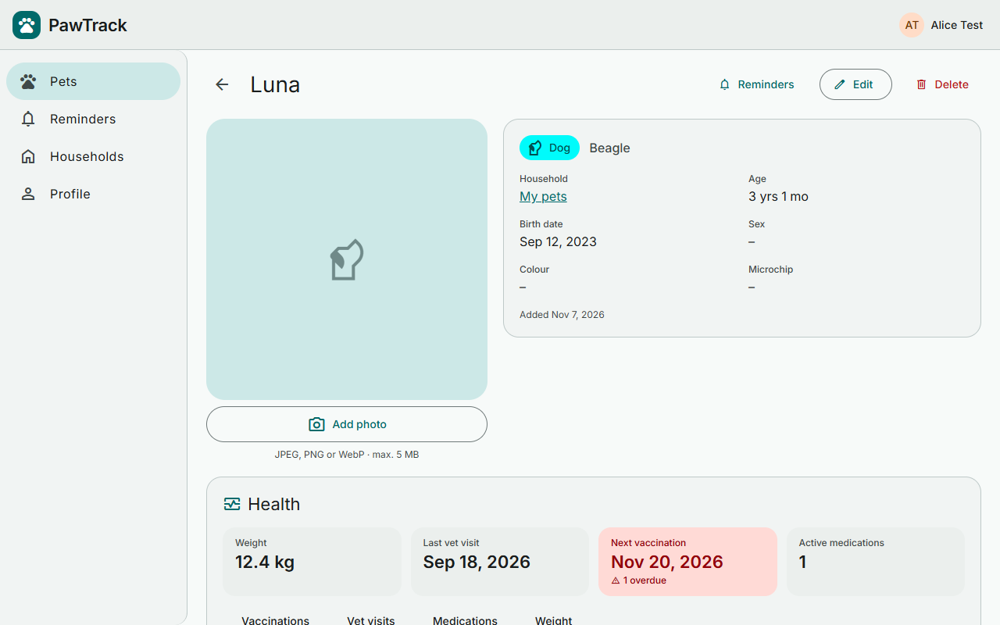
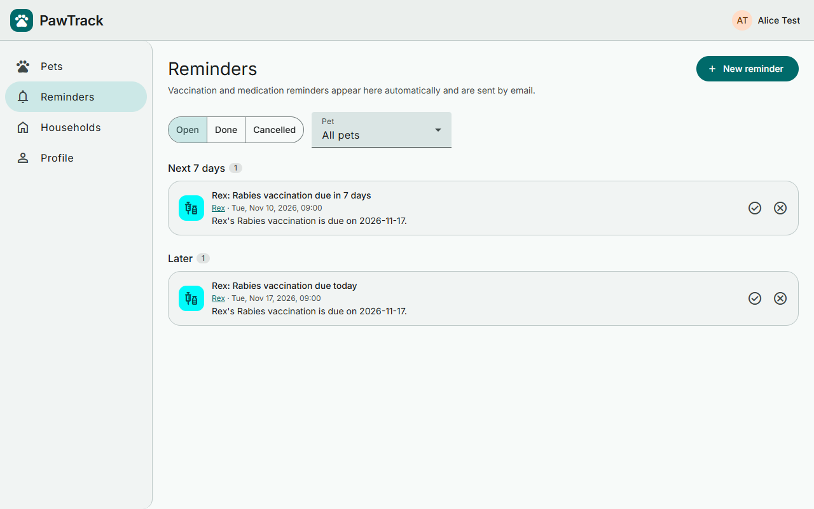
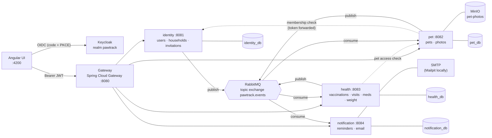
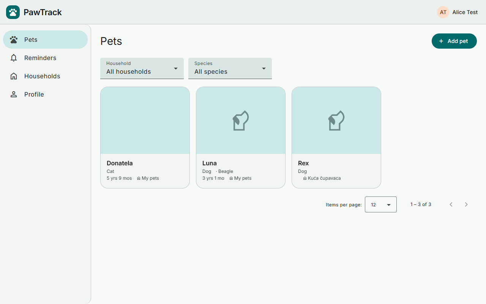
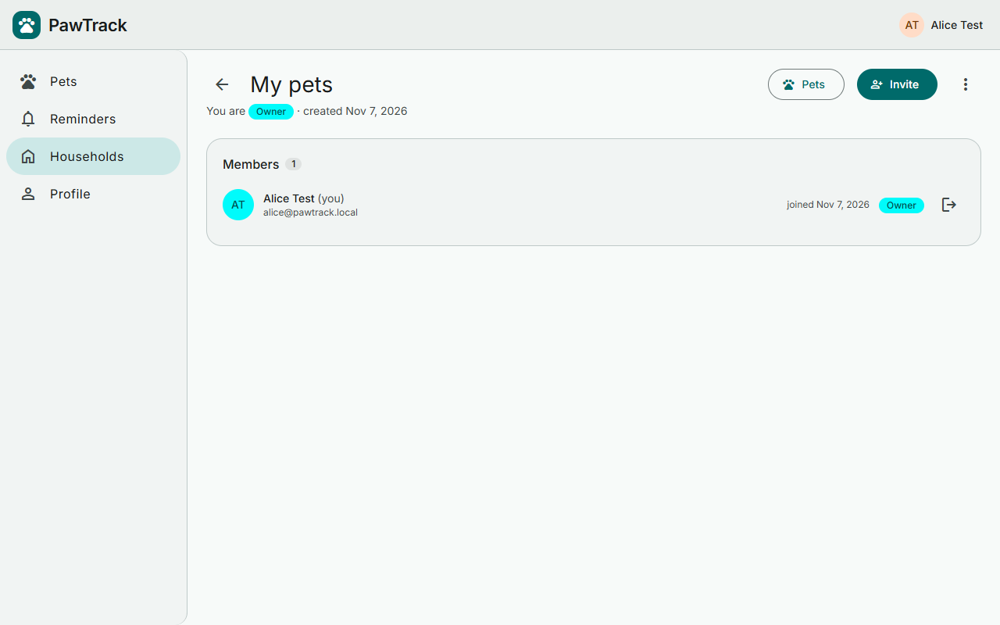
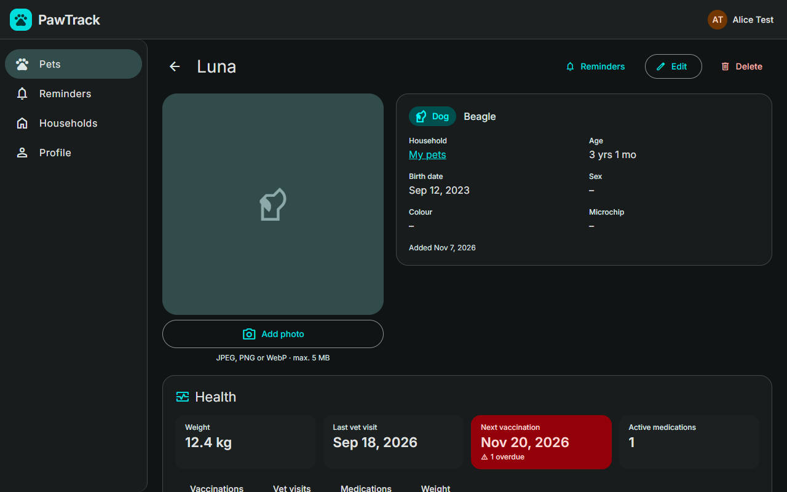

# 🐾 PawTrack

**Pet-care platform built as event-driven microservices.** Keep pet profiles and health records
(vaccinations, vet visits, medications, weight), share pets with your household or a pet-sitter, and get
email reminders before a vaccination or medication is due.

[](https://github.com/anida21/pawtrack/actions/workflows/identity.yml)
[](https://github.com/anida21/pawtrack/actions/workflows/pet.yml)
[](https://github.com/anida21/pawtrack/actions/workflows/health.yml)
[](https://github.com/anida21/pawtrack/actions/workflows/notification.yml)
[](https://github.com/anida21/pawtrack/actions/workflows/gateway.yml)
[](https://github.com/anida21/pawtrack/actions/workflows/ui.yml)


<p align="center">
  
  
</p>

## Architecture



| Service | Responsibility | Publishes | Consumes |
|---|---|---|---|
| [identity](pawtrack-identity) | Users (provisioned from the JWT), households, roles OWNER / MEMBER / SITTER, invitations | `user.updated`, `household.*` | – |
| [pet](pawtrack-pet) | Pet profiles, photo upload to MinIO with pre-signed download URLs | `pet.created / updated / deleted` | `household.deleted` |
| [health](pawtrack-health) | Vaccinations, vet visits, medications, weight history, health summary | `health.vaccination.recorded`, `health.medication.*` | `pet.*` |
| [notification](pawtrack-notification) | Reminders generated from events, scheduler that emails due reminders, invitation emails | – | identity, pet and health events |
| [gateway](pawtrack-gateway) | Single entry point: routing, JWT validation, CORS, aggregated Swagger UI | – | – |
| [ui](pawtrack-ui) | Angular 21 + Material 3 (light/dark, responsive) | – | – |
| [development](pawtrack-development) | docker-compose environment, API contracts, Keycloak realm seed, DLQ replay script | – | – |

More detail: [docs/ARCHITECTURE.md](pawtrack-development/docs/ARCHITECTURE.md)

## What this project demonstrates

- **Microservices with a database per service.** Services never share tables. They talk over REST only
  for access checks and keep small local copies of the data they need, built from events.
- **Event-driven design on RabbitMQ.** A versioned event envelope, published **after commit**. Every consumer
  has a dead-letter queue and is **idempotent** (processed event ids are stored), and failed messages
  can be replayed (`scripts/replay-dlq.mjs`).
- **Contract-first APIs.** OpenAPI files in [`contracts/`](pawtrack-development/contracts) are the source of
  truth. The UI generates its TypeScript API types from them.
- **Security with OAuth2 / OpenID Connect.** Keycloak issues the tokens, the UI signs in with code flow +
  PKCE, every service is a stateless resource server, and authorization is per household and role.
- **Real integration tests.** JUnit 5 + **Testcontainers** (PostgreSQL, RabbitMQ, MinIO, Mailpit),
  330+ backend tests, plus Vitest unit tests in the UI.
- **Production-style build.** Liquibase migrations, MapStruct, RFC 7807 problem responses, actuator
  health probes, multi-stage Docker images that run as a non-root user.
- **CI/CD per service.** Each service has its own GitHub Actions workflow, triggered only by changes in its
  folder, which builds and tests the service and pushes a Docker image to GHCR.

## Screenshots

| Pets | Household |
|---|---|
|  |  |

| Pet health (dark mode) |
|---|
|  |

## Run it locally

Requirements: Docker, plus JDK 17 + Maven and Node 20 if you want to run services outside Docker.

```bash
git clone https://github.com/anida21/pawtrack.git
cd pawtrack/pawtrack-development
docker compose --profile services up -d --build
```

Then start the UI (`cd pawtrack-ui && npm install && npm start`) and open http://localhost:4200.

| | URL | Login (local test data) |
|---|---|---|
| App | http://localhost:4200 | `alice@pawtrack.local` / `alice`, `bob@pawtrack.local` / `bob` |
| Swagger (all APIs) | http://localhost:8080/swagger-ui.html | – |
| Mailpit (sent emails) | http://localhost:8025 | – |
| RabbitMQ | http://localhost:15672 | `pawtrack` / `pawtrack` |
| Keycloak | http://keycloak.localhost:8180 | `admin` / `admin` |

All options (infra only, custom ports, resetting data): [pawtrack-development/README.md](pawtrack-development/README.md).

## Repository layout

```
pawtrack/
├─ pawtrack-development/   docker-compose, contracts/, Keycloak realm, scripts/, docs/
├─ pawtrack-gateway/       Spring Cloud Gateway
├─ pawtrack-identity/      ┐
├─ pawtrack-pet/           │ Spring Boot services: same layout
├─ pawtrack-health/        │ (config, controller, dto, entity, mapper,
├─ pawtrack-notification/  ┘  messaging, repository, service)
├─ pawtrack-ui/            Angular
└─ .github/workflows/      one CI workflow per service
```

## Roadmap

- [ ] Backfill for consumers that start after events were published (outbox / replay endpoint)
- [ ] Evict the pet service's membership cache on `household.member.removed`
- [ ] End-to-end API tests (Jest + TypeScript, clients generated from the contracts)
- [ ] Observability: Prometheus + Grafana, distributed tracing
- [ ] Cloud deployment
